# Arquitectura y tecnologías — HU-39

## Capas

React renderiza la interfaz; Vite sirve el frontend en desarrollo y genera archivos estáticos para producción. Los servicios consumen la API REST Express con `fetch` y JSON. El backend valida, autentica, autoriza y consulta MySQL usando mysql2. No hay ORM ni acceso directo del navegador a MySQL.

```mermaid
flowchart LR
    Usuario[Usuario en navegador] --> UI[React y React Router]
    UI --> Servicios[Servicios frontend: fetch]
    Servicios -->|HTTP local o HTTPS: JSON y Bearer JWT| Rutas[Express: routes]
    Rutas --> Auth[Middleware JWT y roles]
    Auth --> Controladores[Controllers: validación y respuestas]
    Controladores --> Modelos[Models: SQL y transacciones]
    Modelos --> Pool[mysql2: pool]
    Pool -->|MySQL con TLS opcional| DB[(MySQL)]
    DB --> Pool
    Pool --> Modelos
    Modelos --> Controladores
    Controladores -->|Respuesta HTTP JSON| Servicios
```



Express habilita `cors()` sin lista de orígenes y `express.json()`. El pool permite diez conexiones. Algunos controladores ejecutan SQL directamente; no existe una capa de servicios backend separada. Las operaciones compuestas utilizan transacciones según cada modelo.

## Tecnologías y versiones

Los rangos son los declarados en package.json; package-lock.json conserva las versiones resueltas y `npm ci` las reproduce. mysql2 es el driver, no la versión del servidor MySQL.

| Tecnología | Versión declarada / referencia | Uso |
| --- | --- | --- |
| Node.js | No fijada; objetivo local 22.22.2+ de la serie 22 | API y herramientas |
| npm | No fijada | Dependencias y scripts |
| React / React DOM | ^19.2.8 | Interfaz |
| React Router DOM | ^7.18.4 | Navegación |
| Vite | ^8.2.2 | Desarrollo y build |
| @vitejs/plugin-react | ^6.1.0 | Integración React |
| Express | ^5.2.1 | API HTTP |
| MySQL | No fijada; objetivo 8.0.16+ | Persistencia y CHECK efectivos |
| mysql2 | ^3.24.3 | Driver SQL con promesas |
| jsonwebtoken | ^9.0.3 | Firma y validación JWT |
| bcryptjs | ^3.0.3 | Hash de contraseñas |
| dotenv | ^17.4.2 | Entorno backend |
| cors | ^2.8.6 | Acceso entre orígenes |
| ESLint / @eslint/js | ^10.9.0 / ^10.0.1 | Análisis estático |
| eslint-plugin-react-hooks | ^7.1.1 | Reglas de hooks |
| eslint-plugin-react-refresh | ^0.5.4 | Reglas de React Refresh |
| Vitest / @vitest/coverage-v8 | ^5.0.5 | Pruebas frontend/backend y cobertura |
| Nodemailer | ^7.0.13 | Correo de recuperación de contraseña |
| Testing Library React / jest-dom / user-event | ^16.3.3 / ^7.0.1 / ^14.6.8 | Pruebas de componentes y eventos |
| jsdom | ^30.1.3 | DOM simulado en pruebas frontend |
| Git / GitHub | No fijada | Versionado y PR |
| GitHub Actions / Render | Servicios sin versión fijada | CI y hosting previstos; configuración pendiente |

## Carpetas reales

```text
TechService/
├── backend/
│   ├── src/
│   │   ├── config/       # db.js y migraciones históricas
│   │   ├── controllers/  # Validación, coordinación y respuestas
│   │   ├── models/       # SQL y transacciones
│   │   ├── routes/       # Rutas y autorización
│   │   ├── middlewares/  # JWT y roles: middleware activo
│   │   ├── services/     # Correo SMTP
│   │   ├── utils/        # Tokens de recuperación
│   │   ├── validators/   # Validaciones de perfil
│   │   └── index.js      # Express y montaje de rutas
│   ├── middleware/       # Archivo alternativo no importado por las rutas
│   ├── test/             # Pruebas Vitest
│   └── package.json
├── database/
│   ├── schema.sql        # Tablas y restricciones
│   └── base.sql          # Datos de demostración
├── src/
│   ├── components/       # Formularios y paneles reutilizables
│   ├── services/         # Consumo HTTP
│   ├── Pages/            # Páginas y dashboards
│   ├── Css/              # Estilos
│   ├── assets/           # Imágenes
│   ├── App.jsx           # Composición y vistas por rol
│   └── main.jsx          # Entrada React
├── public/               # Recursos estáticos
├── docs/                 # Estas guías
├── test_hu_suite.js       # Suite manual dependiente de API y datos
├── eslint.config.js
├── vite.config.js
└── package.json          # Frontend: no hay carpeta frontend/
```

## JWT y permisos

`POST /api/usuarios/login` compara el password con bcrypt y emite JWT firmado con JWT_SECRET: `sub` es el ID de usuario, `rol` su rol, expiración ocho horas. El middleware activo verifica firma, expiración e ID (`sub` o `id`) y consulta el usuario en MySQL para obtener su rol actual y comprobar que exista y esté activo antes de establecer `req.user`; `authorizeRoles` controla los roles de cada ruta. Algunos controladores comprueban además la propiedad del recurso.

El frontend almacena el token en localStorage (`techservice_token`); api.js lo envía como `Authorization: Bearer <token>`. No hay refresh ni revocación de tokens al cambiar contraseña. El middleware aplica cambios de rol y desactivación consultando MySQL en cada solicitud. El registro público crea siempre CLIENTE y ficha provisional.

| Rol | Permisos generales reales |
| --- | --- |
| ADMIN | Administrar usuarios y técnicos, eliminar clientes sin equipos, asignar órdenes, cancelar cotizaciones y operar módulos internos. No puede crear órdenes o diagnósticos en rutas exclusivas TECNICO. |
| TECNICO | Crear órdenes y diagnósticos; operar equipos, estados, cotizaciones, inventario, mano de obra, recepción y consultas internas. |
| CLIENTE | Perfil propio, equipos propios, historial, seguimiento por código, comprobantes y cotizaciones propios; aprobar/rechazar su cotización. Existe la excepción de consulta por cliente descrita abajo. |

La [API](api.md) detalla permisos por ruta. POST /api/clientes es público y no crea cuenta; no hay alta pública ADMIN.

## Diferencias detectadas

- GET /api/equipos/cliente/:clienteId admite CLIENTE y no verifica propiedad en el controlador.
- GET /api/test-db es público; ejecuta SELECT 1 y devuelve estado de conexión sin listar usuarios.
- Asignar técnico escribe `fecha_asignacion`, ausente de schema.sql y migraciones revisadas.
- technicianService.js, authService.js y Pages/EquiposForm.jsx tienen URLs localhost fijas. authService.js referencia además /usuarios/register y /usuarios/perfil, que no existen. App.jsx usa profileService.js para autenticación.
- No hay workflows de GitHub Actions ni render.yaml versionados. Consultar [despliegue](despliegue.md).

Las HU documentales no modifican estas reglas o rutas; las correcciones funcionales necesitan cambios y validación propios.

La recuperación de contraseña usa tokens aleatorios de 32 bytes enviados por correo; MySQL guarda solo el hash SHA-256, expiración y fecha de uso. Los tokens de recuperación son independientes del JWT. Ver configuración SMTP en instalación y rutas en API.
