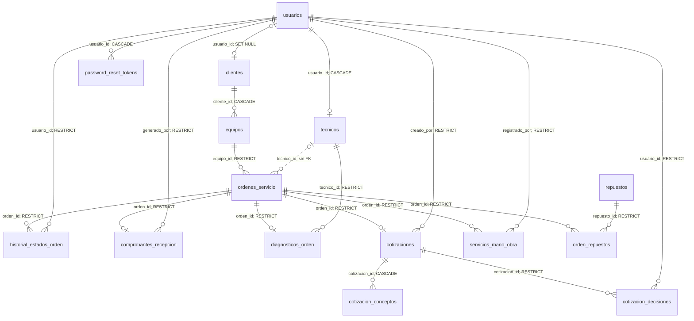

# Modelo de datos — HU-40

Fuente de verdad: [database/schema.sql](../database/schema.sql). Base: techservice_db; 15 tablas. Este diccionario refleja el DDL, no agrega restricciones supuestas por la interfaz. INT sin UNSIGNED admite negativos salvo validación adicional. DECIMAL conserva precisión monetaria. NULL permitido no significa obligatorio en API.

## Diagrama entidad-relación

Líneas continuas: claves foráneas declaradas. Línea punteada: relación lógica de asignación sin FK en schema.sql. Una orden puede carecer de diagnóstico, cotización o comprobante; UNIQUE limita cada uno a uno por orden.

RESTRICT impide eliminar la fila referenciada; CASCADE elimina dependientes; SET NULL conserva la ficha sin vínculo de usuario. No se declara ON UPDATE específico. El modelo permite varias órdenes por equipo y varios consumos del mismo repuesto por orden.

## Diccionario por tabla

La columna Restricciones reproduce la definición SQL e indica NULL implícito cuando no hay NOT NULL/PK. Las FK, CHECK e índices se listan debajo de cada tabla. PK = PRIMARY KEY, identificador único. Los ENUM se reproducen completos para evitar ocultar valores admitidos.

### usuarios

| Columna | Tipo | Restricciones / predeterminado | Descripción |
| --- | --- | --- | --- |
| `id` | `INT` | `AUTO_INCREMENT PRIMARY KEY` | Identificador interno autoincremental. |
| `nombre` | `VARCHAR(100)` | `NOT NULL` | Nombre visible del usuario o repuesto. |
| `email` | `VARCHAR(100)` | `UNIQUE NOT NULL` | Correo electrónico. |
| `activo` | `TINYINT(1)` | `NOT NULL DEFAULT 1` | Acceso lógico: 1 activo, 0 inactivo; sin CHECK booleano. |
| `password` | `VARCHAR(255)` | `NOT NULL` | Hash bcrypt; nunca contraseña en texto plano. |
| `rol` | `ENUM ("ADMIN", "TECNICO", "CLIENTE")` | `NOT NULL` | Rol de autorización del usuario. |
| `creado_en` | `TIMESTAMP` | `NULL implícito; DEFAULT CURRENT_TIMESTAMP` | Fecha/hora de creación del registro. |

### clientes

| Columna | Tipo | Restricciones / predeterminado | Descripción |
| --- | --- | --- | --- |
| `id` | `INT` | `AUTO_INCREMENT PRIMARY KEY` | Identificador interno autoincremental. |
| `usuario_id` | `INT` | `NULL UNIQUE` | Usuario asociado o autor de la operación según tabla. |
| `cedula` | `VARCHAR(20)` | `UNIQUE NOT NULL` | Documento de identidad; en alta de cuenta cliente se genera USR-id. |
| `nombres` | `VARCHAR(100)` | `NOT NULL` | Nombres del cliente. |
| `apellidos` | `VARCHAR(100)` | `NOT NULL` | Apellidos del cliente. |
| `telefono` | `VARCHAR(20)` | `NOT NULL` | Teléfono de contacto. |
| `email` | `VARCHAR(100)` | `UNIQUE NULL` | Correo electrónico. |
| `creado_en` | `TIMESTAMP` | `NULL implícito; DEFAULT CURRENT_TIMESTAMP` | Fecha/hora de creación del registro. |

- `FOREIGN KEY (usuario_id) REFERENCES usuarios(id) ON DELETE SET NULL`

### tecnicos

| Columna | Tipo | Restricciones / predeterminado | Descripción |
| --- | --- | --- | --- |
| `id` | `INT` | `AUTO_INCREMENT PRIMARY KEY` | Identificador interno autoincremental. |
| `usuario_id` | `INT` | `NOT NULL UNIQUE` | Usuario asociado o autor de la operación según tabla. |
| `cedula` | `VARCHAR(20)` | `NOT NULL UNIQUE` | Documento de identidad; en alta de cuenta cliente se genera USR-id. |
| `telefono` | `VARCHAR(20)` | `NOT NULL UNIQUE` | Teléfono de contacto. |
| `especialidad` | `VARCHAR(100)` | `NOT NULL` | Área de trabajo del técnico. |
| `estado` | `ENUM('DISPONIBLE','OCUPADO','INACTIVO')` | `NULL implícito; DEFAULT 'DISPONIBLE'` | Estado del recurso; valores permitidos en el tipo SQL. |
| `creado_en` | `TIMESTAMP` | `NULL implícito; DEFAULT CURRENT_TIMESTAMP` | Fecha/hora de creación del registro. |

- `FOREIGN KEY (usuario_id) REFERENCES usuarios(id) ON DELETE CASCADE`

### equipos

| Columna | Tipo | Restricciones / predeterminado | Descripción |
| --- | --- | --- | --- |
| `id` | `INT` | `AUTO_INCREMENT PRIMARY KEY` | Identificador interno autoincremental. |
| `cliente_id` | `INT` | `NOT NULL` | Cliente propietario del equipo. |
| `tipo` | `VARCHAR(50)` | `NOT NULL` | Tipo de equipo o concepto, según tabla. |
| `modelo` | `VARCHAR(50)` | `NOT NULL` | Modelo del equipo. |
| `marca` | `VARCHAR(100)` | `NULL implícito;` | Fabricante del equipo. |
| `numero_serie` | `VARCHAR(100)` | `NULL implícito;` | Serial del equipo; no es UNIQUE en este esquema. |
| `motivo_ingreso` | `TEXT` | `NULL` | Falla o motivo de recepción. |
| `procesador` | `VARCHAR(100)` | `NULL` | Procesador del equipo. |
| `memoria_ram` | `VARCHAR(50)` | `NULL` | Memoria RAM declarada. |
| `almacenamiento` | `VARCHAR(100)` | `NULL` | Almacenamiento declarado. |
| `tarjeta_grafica` | `VARCHAR(100)` | `NULL` | Tarjeta gráfica declarada. |
| `sistema_operativo` | `VARCHAR(100)` | `NULL` | Sistema operativo. |
| `estado_fisico` | `TEXT` | `NULL` | Condición física de recepción. |
| `accesorios` | `TEXT` | `NULL` | Accesorios recibidos. |
| `observaciones` | `TEXT` | `NULL` | Notas adicionales. |
| `estado` | `ENUM('RECIBIDO', 'EN_REVISION', 'REPARADO', 'ENTREGADO')` | `NULL implícito; DEFAULT 'RECIBIDO'` | Estado del recurso; valores permitidos en el tipo SQL. |
| `fecha_ingreso` | `TIMESTAMP` | `NULL implícito; DEFAULT CURRENT_TIMESTAMP` | Fecha/hora de registro de la decisión. |
| `actualizado_en` | `TIMESTAMP` | `NULL implícito; DEFAULT CURRENT_TIMESTAMP ON UPDATE CURRENT_TIMESTAMP` | Fecha/hora de última actualización automática. |

- `FOREIGN KEY (cliente_id) REFERENCES clientes(id) ON DELETE CASCADE`

### ordenes_servicio

| Columna | Tipo | Restricciones / predeterminado | Descripción |
| --- | --- | --- | --- |
| `id` | `INT` | `AUTO_INCREMENT PRIMARY KEY` | Identificador interno autoincremental. |
| `equipo_id` | `INT` | `NOT NULL` | Equipo objeto de la orden. |
| `codigo_orden` | `VARCHAR(30)` | `NULL UNIQUE` | Código de seguimiento generado como OS-año-ID con relleno mínimo de cuatro dígitos. |
| `tecnico_id` | `INT` | `NULL` | Técnico asignado o autor del diagnóstico; ver FK de cada tabla. |
| `motivo_ingreso` | `TEXT` | `NULL` | Falla o motivo de recepción. |
| `tipo_servicio` | `VARCHAR(80)` | `NULL` | Categoría del servicio; validada por aplicación. |
| `prioridad` | `VARCHAR(20)` | `NOT NULL DEFAULT 'MEDIA'` | Prioridad operativa; validada por aplicación. |
| `costo_estimado` | `DECIMAL(12, 2)` | `NOT NULL DEFAULT 0` | Importe estimado de la orden. |
| `abono_inicial` | `DECIMAL(12, 2)` | `NOT NULL DEFAULT 0` | Importe recibido inicialmente. |
| `observaciones_recepcion` | `TEXT` | `NULL` | Notas de recepción de la orden. |
| `estado` | `ENUM('RECIBIDA', 'PENDIENTE', 'EN_REVISION', 'EN_REPARACION', 'EN_PROCESO', 'EN_ESPERA_REPUESTO', 'REPARADA', 'COMPLETADO', 'ENTREGADA', 'CANCELADA')` | `NOT NULL DEFAULT 'RECIBIDA'` | Estado del recurso; valores permitidos en el tipo SQL. |
| `creada_en` | `TIMESTAMP` | `NULL implícito; DEFAULT CURRENT_TIMESTAMP` | Fecha/hora de creación del registro. |
| `actualizada_en` | `TIMESTAMP` | `NULL implícito; DEFAULT CURRENT_TIMESTAMP ON UPDATE CURRENT_TIMESTAMP` | Fecha/hora de última actualización automática. |

- `FOREIGN KEY (equipo_id) REFERENCES equipos(id) ON DELETE RESTRICT`

### historial_estados_orden

| Columna | Tipo | Restricciones / predeterminado | Descripción |
| --- | --- | --- | --- |
| `id` | `INT` | `AUTO_INCREMENT PRIMARY KEY` | Identificador interno autoincremental. |
| `orden_id` | `INT` | `NOT NULL` | Orden de servicio relacionada. |
| `estado_anterior` | `VARCHAR(30)` | `NULL` | Estado previo; NULL para registro inicial. |
| `estado_nuevo` | `VARCHAR(30)` | `NOT NULL` | Estado registrado en el evento. |
| `usuario_id` | `INT` | `NOT NULL` | Usuario asociado o autor de la operación según tabla. |
| `observacion` | `TEXT` | `NULL` | Nota del cambio de estado. |
| `creado_en` | `TIMESTAMP` | `NULL implícito; DEFAULT CURRENT_TIMESTAMP` | Fecha/hora de creación del registro. |

- `FOREIGN KEY (orden_id) REFERENCES ordenes_servicio(id) ON DELETE RESTRICT`
- `FOREIGN KEY (usuario_id) REFERENCES usuarios(id) ON DELETE RESTRICT`
- `INDEX idx_historial_orden_fecha (orden_id, creado_en, id)`

### comprobantes_recepcion

| Columna | Tipo | Restricciones / predeterminado | Descripción |
| --- | --- | --- | --- |
| `id` | `INT` | `AUTO_INCREMENT PRIMARY KEY` | Identificador interno autoincremental. |
| `orden_id` | `INT` | `NOT NULL UNIQUE` | Orden de servicio relacionada. |
| `numero_comprobante` | `VARCHAR(40)` | `NOT NULL UNIQUE` | Número único del comprobante. |
| `generado_por` | `INT` | `NOT NULL` | Usuario que generó el comprobante. |
| `falla_reportada` | `TEXT` | `NOT NULL` | Falla informada al recibir. |
| `estado_fisico` | `TEXT` | `NOT NULL` | Condición física de recepción. |
| `accesorios` | `TEXT` | `NOT NULL` | Accesorios recibidos. |
| `observaciones` | `TEXT` | `NULL` | Notas adicionales. |
| `fecha_recepcion` | `TIMESTAMP` | `NOT NULL` | Fecha/hora de recepción conservada en el comprobante. |
| `creado_en` | `TIMESTAMP` | `NULL implícito; DEFAULT CURRENT_TIMESTAMP` | Fecha/hora de creación del registro. |

- `FOREIGN KEY (orden_id) REFERENCES ordenes_servicio(id) ON DELETE RESTRICT`
- `FOREIGN KEY (generado_por) REFERENCES usuarios(id) ON DELETE RESTRICT`

### diagnosticos_orden

| Columna | Tipo | Restricciones / predeterminado | Descripción |
| --- | --- | --- | --- |
| `id` | `INT` | `AUTO_INCREMENT PRIMARY KEY` | Identificador interno autoincremental. |
| `orden_id` | `INT` | `NOT NULL UNIQUE` | Orden de servicio relacionada. |
| `tecnico_id` | `INT` | `NOT NULL` | Técnico asignado o autor del diagnóstico; ver FK de cada tabla. |
| `descripcion` | `TEXT` | `NOT NULL` | Descripción del diagnóstico, concepto, servicio o repuesto. |
| `falla_encontrada` | `TEXT` | `NOT NULL` | Falla identificada por diagnóstico. |
| `fecha_diagnostico` | `DATETIME` | `NOT NULL` | Fecha/hora declarada del diagnóstico. |
| `recomendaciones` | `TEXT` | `NULL` | Recomendaciones del técnico. |
| `procedimientos` | `TEXT` | `NULL` | Procedimientos realizados o propuestos. |
| `observaciones` | `TEXT` | `NULL` | Notas adicionales. |
| `creado_en` | `TIMESTAMP` | `NULL implícito; DEFAULT CURRENT_TIMESTAMP` | Fecha/hora de creación del registro. |
| `actualizado_en` | `TIMESTAMP` | `NULL implícito; DEFAULT CURRENT_TIMESTAMP ON UPDATE CURRENT_TIMESTAMP` | Fecha/hora de última actualización automática. |

- `FOREIGN KEY (orden_id) REFERENCES ordenes_servicio(id) ON DELETE RESTRICT`
- `FOREIGN KEY (tecnico_id) REFERENCES tecnicos(id) ON DELETE RESTRICT`

### cotizaciones

| Columna | Tipo | Restricciones / predeterminado | Descripción |
| --- | --- | --- | --- |
| `id` | `INT` | `AUTO_INCREMENT PRIMARY KEY` | Identificador interno autoincremental. |
| `orden_id` | `INT` | `NOT NULL UNIQUE` | Orden de servicio relacionada. |
| `creado_por` | `INT` | `NOT NULL` | Usuario creador de la cotización. |
| `estado` | `ENUM('PENDIENTE_APROBACION', 'APROBADA', 'RECHAZADA', 'CANCELADA')` | `NOT NULL DEFAULT 'PENDIENTE_APROBACION'` | Estado del recurso; valores permitidos en el tipo SQL. |
| `subtotal` | `DECIMAL(12, 2)` | `NOT NULL DEFAULT 0` | Subtotal calculado por el servidor, incluyendo mano de obra separada. |
| `total` | `DECIMAL(12, 2)` | `NOT NULL DEFAULT 0` | Total calculado; actualmente coincide con subtotal. |
| `creada_en` | `TIMESTAMP` | `NULL implícito; DEFAULT CURRENT_TIMESTAMP` | Fecha/hora de creación del registro. |
| `actualizada_en` | `TIMESTAMP` | `NULL implícito; DEFAULT CURRENT_TIMESTAMP ON UPDATE CURRENT_TIMESTAMP` | Fecha/hora de última actualización automática. |

- `FOREIGN KEY (orden_id) REFERENCES ordenes_servicio(id) ON DELETE RESTRICT`
- `FOREIGN KEY (creado_por) REFERENCES usuarios(id) ON DELETE RESTRICT`

### cotizacion_conceptos

| Columna | Tipo | Restricciones / predeterminado | Descripción |
| --- | --- | --- | --- |
| `id` | `INT` | `AUTO_INCREMENT PRIMARY KEY` | Identificador interno autoincremental. |
| `cotizacion_id` | `INT` | `NOT NULL` | Cotización relacionada. |
| `tipo` | `ENUM('SERVICIO', 'MANO_OBRA', 'REPUESTO')` | `NOT NULL` | Tipo de equipo o concepto, según tabla. |
| `descripcion` | `VARCHAR(255)` | `NOT NULL` | Descripción del diagnóstico, concepto, servicio o repuesto. |
| `cantidad` | `DECIMAL(10, 2)` | `NOT NULL` | Unidades de concepto o repuesto; puede ser decimal solo en conceptos. |
| `precio_unitario` | `DECIMAL(12, 2)` | `NOT NULL` | Precio por unidad; en orden_repuestos conserva el precio del consumo. |
| `observaciones` | `TEXT` | `NULL` | Notas adicionales. |

- `FOREIGN KEY (cotizacion_id) REFERENCES cotizaciones(id) ON DELETE CASCADE`
- `CHECK (cantidad > 0)`
- `CHECK (precio_unitario >= 0)`

### cotizacion_decisiones

| Columna | Tipo | Restricciones / predeterminado | Descripción |
| --- | --- | --- | --- |
| `id` | `INT` | `AUTO_INCREMENT PRIMARY KEY` | Identificador interno autoincremental. |
| `cotizacion_id` | `INT` | `NOT NULL` | Cotización relacionada. |
| `estado` | `ENUM('APROBADA', 'RECHAZADA')` | `NOT NULL` | Estado del recurso; valores permitidos en el tipo SQL. |
| `usuario_id` | `INT` | `NOT NULL` | Usuario asociado o autor de la operación según tabla. |
| `registrado_en` | `TIMESTAMP` | `NULL implícito; DEFAULT CURRENT_TIMESTAMP` | Fecha/hora de registro de la decisión. |

- `FOREIGN KEY (cotizacion_id) REFERENCES cotizaciones(id) ON DELETE RESTRICT`
- `FOREIGN KEY (usuario_id) REFERENCES usuarios(id) ON DELETE RESTRICT`
- `INDEX idx_decisiones_cotizacion_fecha (cotizacion_id, registrado_en, id)`

### servicios_mano_obra

| Columna | Tipo | Restricciones / predeterminado | Descripción |
| --- | --- | --- | --- |
| `id` | `INT` | `AUTO_INCREMENT PRIMARY KEY` | Identificador interno autoincremental. |
| `orden_id` | `INT` | `NOT NULL` | Orden de servicio relacionada. |
| `descripcion` | `VARCHAR(255)` | `NOT NULL` | Descripción del diagnóstico, concepto, servicio o repuesto. |
| `costo` | `DECIMAL(12, 2)` | `NOT NULL` | Costo del servicio de mano de obra. |
| `tiempo_minutos` | `INT` | `NULL` | Duración estimada/registrada en minutos. |
| `registrado_por` | `INT` | `NOT NULL` | Usuario que registró el servicio. |
| `creado_en` | `TIMESTAMP` | `NULL implícito; DEFAULT CURRENT_TIMESTAMP` | Fecha/hora de creación del registro. |
| `actualizado_en` | `TIMESTAMP` | `NULL implícito; DEFAULT CURRENT_TIMESTAMP ON UPDATE CURRENT_TIMESTAMP` | Fecha/hora de última actualización automática. |

- `FOREIGN KEY (orden_id) REFERENCES ordenes_servicio(id) ON DELETE RESTRICT`
- `FOREIGN KEY (registrado_por) REFERENCES usuarios(id) ON DELETE RESTRICT`
- `CHECK (costo >= 0)`
- `CHECK (tiempo_minutos IS NULL OR tiempo_minutos > 0)`
- `INDEX idx_mano_obra_orden (orden_id, id)`

### repuestos

| Columna | Tipo | Restricciones / predeterminado | Descripción |
| --- | --- | --- | --- |
| `id` | `INT` | `AUTO_INCREMENT PRIMARY KEY` | Identificador interno autoincremental. |
| `nombre` | `VARCHAR(100)` | `NOT NULL` | Nombre visible del usuario o repuesto. |
| `descripcion` | `TEXT` | `NULL` | Descripción del diagnóstico, concepto, servicio o repuesto. |
| `stock` | `INT` | `NOT NULL DEFAULT 0` | Cantidad disponible en inventario. |
| `precio_unitario` | `DECIMAL(12, 2)` | `NOT NULL DEFAULT 0` | Precio por unidad; en orden_repuestos conserva el precio del consumo. |
| `creado_en` | `TIMESTAMP` | `NULL implícito; DEFAULT CURRENT_TIMESTAMP` | Fecha/hora de creación del registro. |
| `actualizado_en` | `TIMESTAMP` | `NULL implícito; DEFAULT CURRENT_TIMESTAMP ON UPDATE CURRENT_TIMESTAMP` | Fecha/hora de última actualización automática. |

- `CHECK (stock >= 0)`
- `CHECK (precio_unitario >= 0)`

### orden_repuestos

| Columna | Tipo | Restricciones / predeterminado | Descripción |
| --- | --- | --- | --- |
| `id` | `INT` | `AUTO_INCREMENT PRIMARY KEY` | Identificador interno autoincremental. |
| `orden_id` | `INT` | `NOT NULL` | Orden de servicio relacionada. |
| `repuesto_id` | `INT` | `NOT NULL` | Repuesto consumido de inventario. |
| `cantidad` | `INT` | `NOT NULL` | Unidades de concepto o repuesto; puede ser decimal solo en conceptos. |
| `precio_unitario` | `DECIMAL(12, 2)` | `NOT NULL` | Precio por unidad; en orden_repuestos conserva el precio del consumo. |
| `subtotal` | `DECIMAL(12, 2)` | `NOT NULL` | Subtotal calculado por el servidor, incluyendo mano de obra separada. |
| `creado_en` | `TIMESTAMP` | `NULL implícito; DEFAULT CURRENT_TIMESTAMP` | Fecha/hora de creación del registro. |

- `FOREIGN KEY (orden_id) REFERENCES ordenes_servicio(id) ON DELETE RESTRICT`
- `FOREIGN KEY (repuesto_id) REFERENCES repuestos(id) ON DELETE RESTRICT`
- `CHECK (cantidad > 0)`

## Coherencia y diferencias con la aplicación

- ordenes_servicio.tecnico_id es nullable sin FOREIGN KEY; diagnosticos_orden.tecnico_id sí referencia tecnicos.
- fecha_asignacion se usa al asignar en ordenServicioModel.js pero no existe en este DDL ni en las migraciones revisadas. Esa ruta puede fallar en una base nueva.
- numero_serie no es único; equipo_id de una orden tampoco. Algunos mensajes de error históricos mencionan duplicidad aunque el esquema actual permite varios registros.
- cotizacion_decisiones no tiene UNIQUE por cotización: el modelo limita decisiones mediante lógica y bloqueo transaccional.
- Roles y estados ENUM se restringen en SQL, pero prioridad y tipo_servicio son VARCHAR: sus catálogos se validan solo en aplicación.
- base.sql es semilla de demostración, no diccionario ni migración. Sus usuarios no incluyen ficha TECNICO ni contraseña conocida.
- Ver [reglas de negocio](reglas-negocio.md) para distinguir transiciones de estados efectivas de un flujo operativo sugerido.

### password_reset_tokens

| Columna | Tipo | Restricciones / predeterminado | Descripción |
| --- | --- | --- | --- |
| id | INT | AUTO_INCREMENT PRIMARY KEY | Identificador del token de recuperación. |
| usuario_id | INT | NOT NULL; FK usuarios(id) | Usuario solicitante. |
| token_hash | CHAR(64) | NOT NULL UNIQUE | Hash SHA-256; no se guarda el token original. |
| expira_en | DATETIME | NOT NULL | Límite de vigencia calculado con NOW() de MySQL. |
| usado_en | DATETIME | NULL | Fecha de consumo o invalidación. |
| creado_en | TIMESTAMP | NULL implícito; DEFAULT CURRENT_TIMESTAMP | Fecha de emisión. |

- `INDEX idx_password_reset_usuario (usuario_id, creado_en)`
- `FOREIGN KEY (usuario_id) REFERENCES usuarios(id) ON DELETE CASCADE`
- `ENGINE=InnoDB`, también explícito en usuarios, clientes y equipos; las otras tablas usan el motor predeterminado del servidor.
