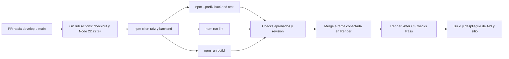

# GitHub Actions y despliegue en Render

## Estado comprobado

En el árbol revisado no existe `.github/workflows/` ni `render.yaml` versionado. No se puede afirmar que haya pipeline de pruebas, lint y despliegue activo, ni deducir URLs o configuración de servicios Render a partir del repositorio. Lo siguiente documenta los comandos disponibles y una propuesta concreta para configurar CI/CD. Hasta integrar y ejecutar un workflow, el criterio de pipeline operativo permanece pendiente.

## Pipeline propuesto

Crear un workflow en `.github/workflows/ci.yml` con eventos `pull_request` y `push` para develop/main, runner Ubuntu, actions/checkout, actions/setup-node con Node 22.22.2+ de la serie 22 y pasos `npm ci`, `npm --prefix backend ci`, `npm --prefix backend test`, `npm test`, `npm run lint` y `npm run build`. Las versiones de las acciones deben fijarse al implementarlo. No necesita secretos de producción: Vitest simula modelos/pool sin MySQL. El build puede usar VITE_API_URL de pruebas porque solo comprueba compilación.

Configurar checks obligatorios y revisión de PR en GitHub. No omitir errores con continue-on-error. Las pruebas actuales usan dobles de modelos, pool y fetch; no prueban MySQL real; test_hu_suite.js necesita adaptación a JWT y datos aislados antes de incorporarse al pipeline.

Para CD se propone conectar Render a la rama de entrega y seleccionar **After CI Checks Pass**. Así Actions ejecuta validaciones y Render realiza el despliegue después de pasar checks del commit; no existe un job de despliegue en Actions actualmente. Render no despliega con esa opción si no encuentra checks o alguno falla. Fuente: [documentación de despliegues de Render](https://render.com/docs/deploys).

## Preparación de MySQL

Usar un servidor MySQL accesible desde el servicio backend con usuario y permisos propios; ejecutar schema.sql y después base.sql con una cuenta administrativa, como en [instalación](instalacion.md). Confirmar reglas de red y TLS del proveedor. MySQL es un servicio separado del sitio React y la API. No ejecutar semillas en cada arranque o build. Revisar antes el problema de fecha_asignacion y no asumir que los datos semilla proporcionan credenciales funcionales.

## Backend en Render

Crear un **Web Service** conectado al repositorio:

| Campo | Valor para este proyecto |
| --- | --- |
| Rama | Rama de entrega acordada, por ejemplo main |
| Root Directory | backend |
| Runtime | Node compatible; fijar 22.22.2+ de la serie 22 |
| Build Command | npm ci |
| Start Command | npm start |
| Variables privadas | DB_HOST, DB_PORT, DB_USER, DB_PASSWORD, DB_NAME, DB_SSL, JWT_SECRET, FRONTEND_URL y SMTP según instalación |
| Puerto | Usar PORT proporcionado por Render; index.js ya lo lee |

Configurar DB_SSL según el proveedor; el código actual usa rejectUnauthorized:false y no valida el certificado. No cargar .env reales al repo. Verificar logs y una operación autenticada con una cuenta de prueba. `/api/test-db` ejecuta SELECT 1 públicamente y devuelve status/mensaje sin usuarios; puede comprobar conectividad.

Referencia: [servicios Express en Render](https://render.com/docs/deploy-node-express-app).

## Frontend en Render

Crear un **Static Site** del mismo repositorio:

| Campo | Valor |
| --- | --- |
| Root Directory | Raíz del repositorio (vacío) |
| Build Command | npm ci && npm run build |
| Publish Directory | dist |
| Variable de build | VITE_API_URL=https://NOMBRE-API.onrender.com/api |
| Rewrite para React Router | /* → /index.html, acción Rewrite |

Usar el host real de la API, incluir /api y reconstruir el sitio después de cambiar variables VITE_*. Son valores públicos incorporados al JavaScript, no secretos. Validar navegación directa y recarga de rutas internas, login, permisos y consultas de datos. Referencia: [sitios estáticos de Render](https://render.com/docs/static-sites).

**Limitaciones que deben resolverse para publicar todas las pantallas:** technicianService.js y Pages/EquiposForm.jsx consultan localhost; authService.js también tiene localhost y rutas antiguas. Cambiar VITE_API_URL solo afecta consumidores de api.js. Antes de una entrega funcional completa hay que centralizar esos consumidores y verificar el flujo remoto. El CORS actual permite todos los orígenes, no hay configuración de allowlist por variable.

## Verificación y recuperación

Después de configurar servicios, registrar en el PR las URLs públicas (sin secretos), rama conectada, ejecución de checks y despliegue que corresponda al commit. Si falla CI, corregir antes de integrar. Si falla un build de Render, consultar logs; un despliegue fallido conserva la versión previa según su documentación. Revisar por separado cambios SQL: restaurar una versión de aplicación no revierte la base de datos; respaldar antes de migraciones.

Al implementar CI en Linux revisar la dependencia raíz lightningcss-win32-x64-msvc, específica de Windows: la portabilidad de npm ci en Ubuntu no se ha verificado. El pipeline descrito es una propuesta que requiere validación en su runner.
